<!-- Estilos de la galería acá (y no en styles.css) para que nunca se vea sin ellos por caché del navegador -->
<style>
  .galeria {
    display: grid;
    grid-template-columns: repeat(3, 1fr);
    gap: 0.75rem;
    margin-top: 2rem;
  }

  .galeria a {
    display: block;
    overflow: hidden;
    border-radius: 8px;
    border-bottom: none;
    background-color: #f5f5f5;
    aspect-ratio: 3 / 2;
  }

  .galeria img {
    display: block;
    width: 100%;
    height: 100%;
    object-fit: cover;
    margin: 0;
    transition: transform 0.3s ease;
  }

  .galeria a:hover img,
  .galeria a:focus img {
    transform: scale(1.04);
  }

  .visor {
    position: fixed;
    inset: 0;
    z-index: 2000;
    display: none;
    align-items: center;
    justify-content: center;
    background-color: rgba(10, 10, 20, 0.92);
  }

  .visor.abierto {
    display: flex;
  }

  .visor img {
    max-width: 92vw;
    max-height: 86vh;
    border-radius: 6px;
  }

  .visor button {
    position: absolute;
    border: none;
    background: none;
    color: #ffffff;
    font-size: 2.5rem;
    line-height: 1;
    padding: 1rem;
    cursor: pointer;
    opacity: 0.8;
  }

  .visor button:hover,
  .visor button:focus {
    opacity: 1;
    color: #98D161;
  }

  .visor .visor-cerrar { top: 0.5rem; right: 0.75rem; }
  .visor .visor-anterior { left: 0.5rem; top: 50%; transform: translateY(-50%); }
  .visor .visor-siguiente { right: 0.5rem; top: 50%; transform: translateY(-50%); }

  .visor .visor-contador {
    position: absolute;
    bottom: 1rem;
    color: rgba(255, 255, 255, 0.75);
    font-size: 0.9rem;
  }

  @media (max-width: 768px) {
    .galeria {
      grid-template-columns: repeat(2, 1fr);
      gap: 0.5rem;
    }
  }
</style>

```{=html}
<nav class="summit-nav" aria-label="Summit 2026">
  <a href="index.html" class="summit-nav-volver">← Volver al Summit 2026</a>
  <span class="summit-nav-tabs">
    <a href="fotos.html" aria-current="page">Fotos</a>
    <a href="prensa.html">Prensa</a>
  </span>
</nav>
```

<!-- Para sumar una foto: guardala en img/ (1600 px de ancho) y su miniatura en img/mini/ (640 px), y copiá un bloque <a> -->
```{=html}
<div class="galeria">
  <a href="img/img_1681.jpg">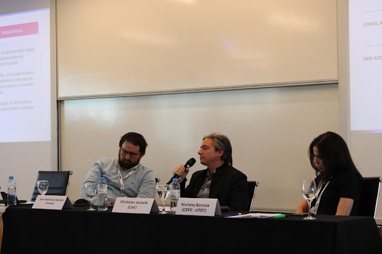</a>
  <a href="img/img_1698.jpg">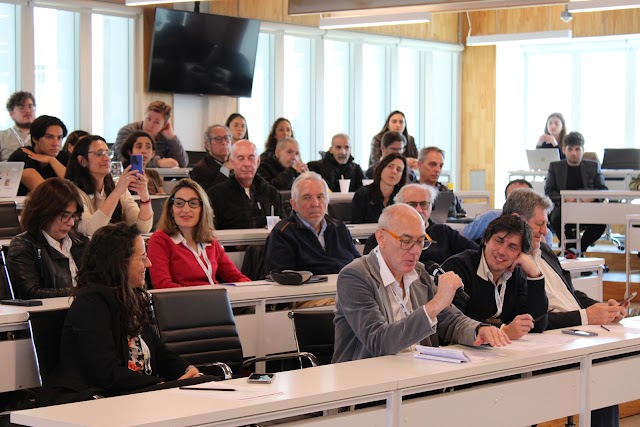</a>
  <a href="img/img_1707.jpg">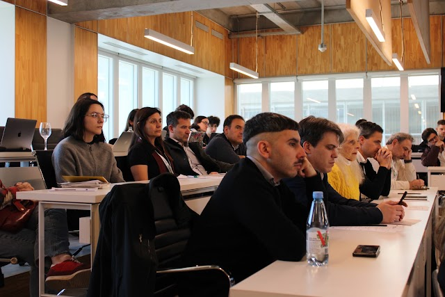</a>
  <a href="img/img_1715.jpg">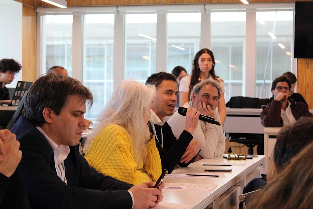</a>
  <a href="img/img_1722.jpg">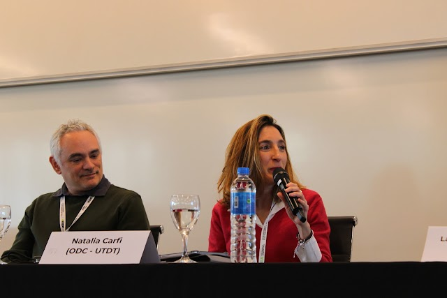</a>
  <a href="img/img_1728.jpg">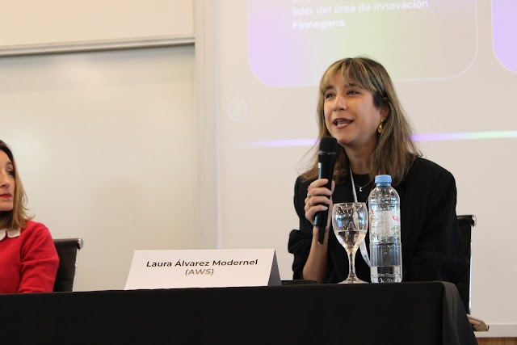</a>
  <a href="img/img_1738.jpg">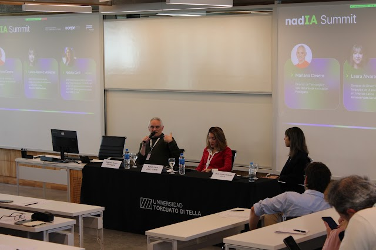</a>
  <a href="img/img_1739.jpg">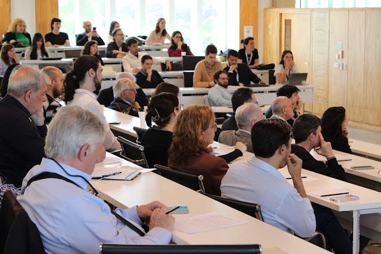</a>
  <a href="img/img_1743.jpg">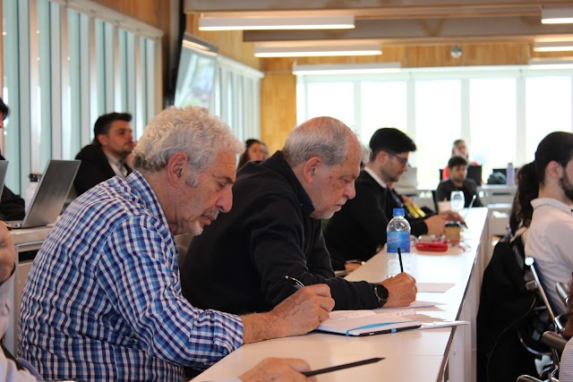</a>
  <a href="img/img_1744.jpg">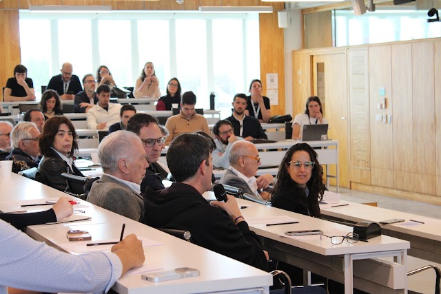</a>
  <a href="img/img_1761.jpg">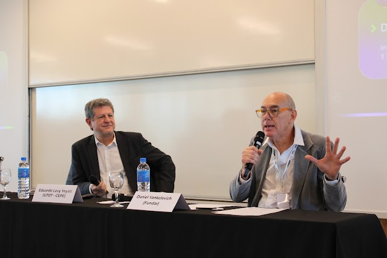</a>
  <a href="img/img_1763.jpg">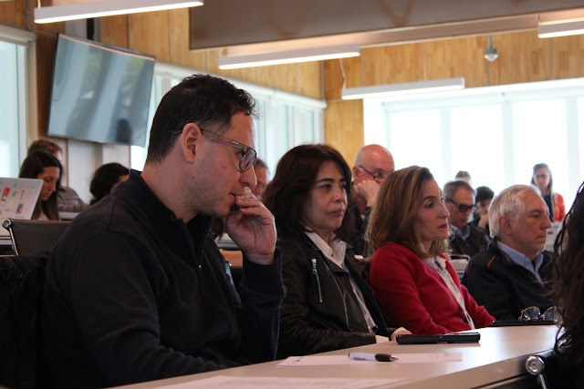</a>
  <a href="img/img_1767.jpg">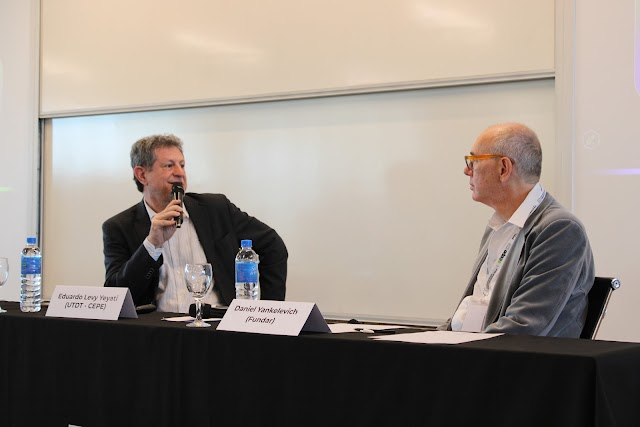</a>
  <a href="img/img_1772.jpg">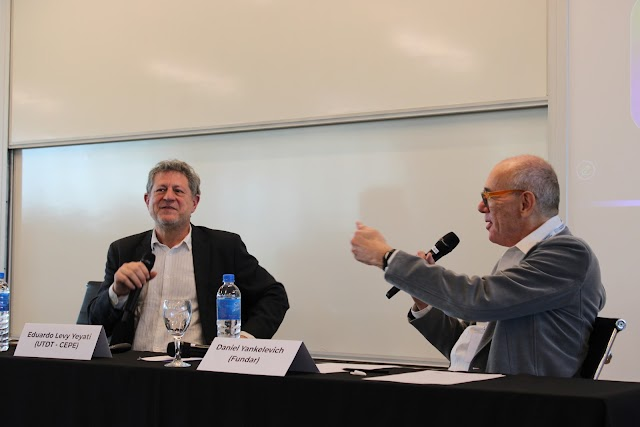</a>
  <a href="img/img_1791.jpg">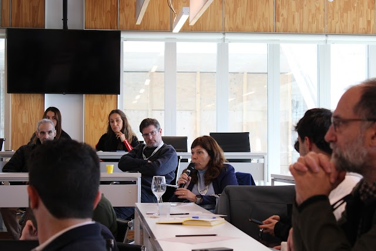</a>
  <a href="img/img_1793.jpg">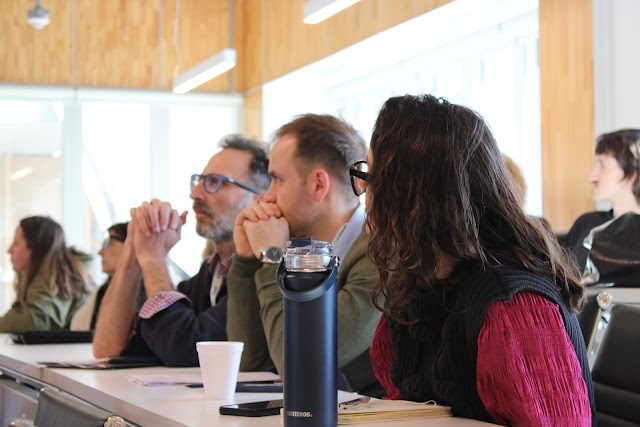</a>
  <a href="img/img_1794.jpg">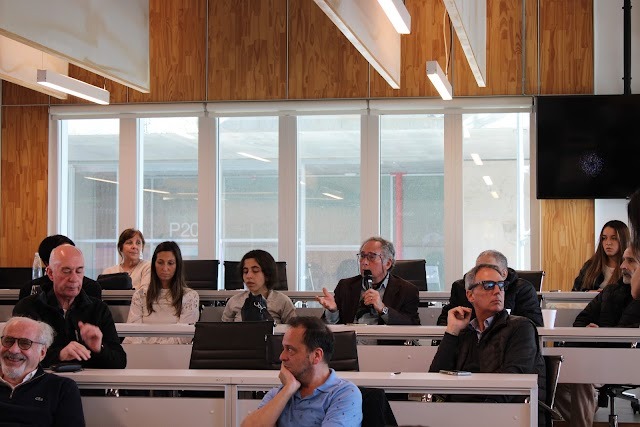</a>
  <a href="img/img_1800.jpg">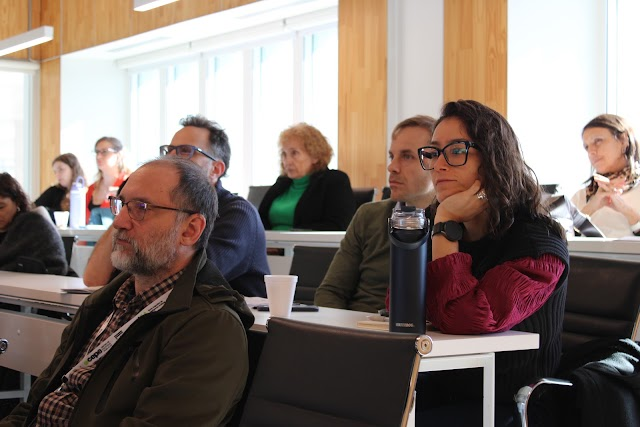</a>
  <a href="img/mislej_3.jpg">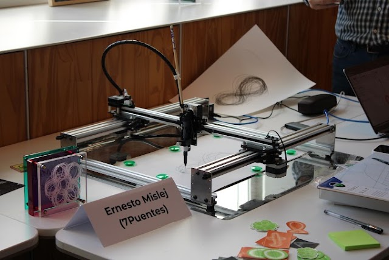</a>
  <a href="img/mislej.jpg">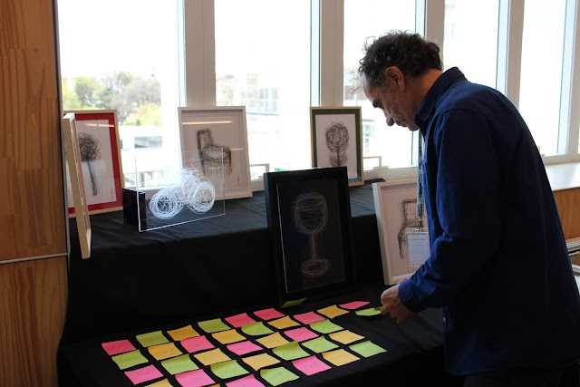</a>
</div>

<div class="visor" id="visor" role="dialog" aria-modal="true" aria-label="Foto ampliada">
  <button class="visor-cerrar" type="button" aria-label="Cerrar">&times;</button>
  <button class="visor-anterior" type="button" aria-label="Foto anterior">&lsaquo;</button>
  
  <button class="visor-siguiente" type="button" aria-label="Foto siguiente">&rsaquo;</button>
  <span class="visor-contador"></span>
</div>

<script>
  // Visor de fotos: abre la versión grande al hacer clic y permite recorrerlas con flechas
  (function () {
    var enlaces = Array.prototype.slice.call(document.querySelectorAll(".galeria a"));
    var visor = document.getElementById("visor");
    var img = visor.querySelector("img");
    var contador = visor.querySelector(".visor-contador");
    var actual = 0;

    function mostrar(i) {
      actual = (i + enlaces.length) % enlaces.length;
      img.src = enlaces[actual].href;
      img.alt = enlaces[actual].querySelector("img").alt;
      contador.textContent = (actual + 1) + " / " + enlaces.length;
    }

    function abrir(i) {
      mostrar(i);
      visor.classList.add("abierto");
      document.body.style.overflow = "hidden";
      visor.querySelector(".visor-cerrar").focus();
    }

    function cerrar() {
      visor.classList.remove("abierto");
      document.body.style.overflow = "";
      enlaces[actual].focus();
    }

    enlaces.forEach(function (a, i) {
      a.addEventListener("click", function (e) {
        e.preventDefault();
        abrir(i);
      });
    });

    visor.querySelector(".visor-cerrar").addEventListener("click", cerrar);
    visor.querySelector(".visor-anterior").addEventListener("click", function () { mostrar(actual - 1); });
    visor.querySelector(".visor-siguiente").addEventListener("click", function () { mostrar(actual + 1); });
    visor.addEventListener("click", function (e) {
      if (e.target === visor) cerrar();
    });

    document.addEventListener("keydown", function (e) {
      if (!visor.classList.contains("abierto")) return;
      if (e.key === "Escape") cerrar();
      if (e.key === "ArrowLeft") mostrar(actual - 1);
      if (e.key === "ArrowRight") mostrar(actual + 1);
    });
  })();
</script>
```

```{=html}
<nav class="summit-nav summit-nav-pie" aria-label="Summit 2026">
  <a href="index.html" class="summit-nav-volver">← Volver al Summit 2026</a>
  <span class="summit-nav-tabs">
    <a href="fotos.html" aria-current="page">Fotos</a>
    <a href="prensa.html">Prensa</a>
  </span>
</nav>
```

<footer class="site-footer">
  
</footer>
